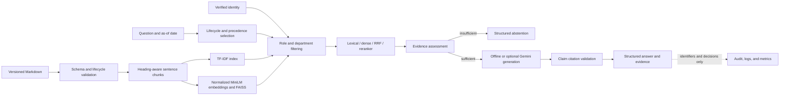

# AcmeFlow Enterprise RAG Reliability & Governance Platform

AcmeFlow is a reference implementation of an evidence-grounded retrieval-augmented generation
service for versioned enterprise documents. It separates document eligibility, authorization,
retrieval, evidence assessment, generation, and citation validation so each decision can be
tested and evaluated independently.

The default configuration runs locally with deterministic generation. Google Cloud adapters are
optional and have mock-based test coverage only. No GCP deployment or live Gemini integration has
been verified, and the project does not claim production readiness.

## Capabilities

- validated Markdown ingestion with lifecycle metadata and stable, section-aware chunks;
- TF-IDF, MiniLM/FAISS, reciprocal-rank-fused hybrid, and cross-encoder-reranked retrieval;
- role, department, effective-date, and customer-policy filtering before reranking or generation;
- strategy-specific evidence assessment and pre-generation abstention;
- structured answers with claim-to-chunk mappings and authorized citation validation;
- deterministic offline generation and an optional Vertex AI Gemini adapter;
- local and GCS artifact-store adapters with manifest and checksum validation;
- FastAPI endpoints, metadata-only audit events, structured logs, operational metrics, Docker,
  CI, and manually gated deployment configuration; and
- reproducible retrieval, governance, abstention, grounding, and answer-quality evaluation.

## Architecture



Authorization and version eligibility are applied before candidates enter fusion, reranking,
generation, logs, or returned citations. See [Architecture](docs/ARCHITECTURE.md) and
[Governance and security](docs/GOVERNANCE.md) for implementation and trust-boundary details.

## Quick start

Python 3.12 is the validated runtime. Fresh dependency installation requires access to the Python
package index.

```bash
python3.12 -m venv .venv
# Windows PowerShell: .\.venv\Scripts\Activate.ps1
# macOS/Linux: source .venv/bin/activate
python -m pip install --requirement requirements.lock
python -m pip install --no-build-isolation --no-deps -e .
```

Build the deterministic lexical index for the lifecycle-aware corpus:

```bash
python -m acmeflow_rag.ingest --retriever tfidf --corpus data/documents_v3 --artifacts-dir artifacts/v3/tfidf --max-words 40 --overlap-words 10 --corpus-version v3 --require-lifecycle
```

Expected summary:

```text
Retriever: tfidf
Loaded documents: 11
Created chunks: 45
Chunk words: min=13 median=35 max=40
```

Run an offline query:

```bash
python -m acmeflow_rag.demo --strategy lexical --token dev-support-token --as-of 2026-06-15 --question "Does cancellation automatically refund the last charge, and what must Support verify?"
```

The response includes answerability status, a reason code, document and chunk IDs, evidence
passages, structured claims, and claim-to-evidence mappings. See [Local demonstration](docs/DEMO.md)
for grounded, denied, and unanswerable scenarios.

## Retrieval strategies

The service and evaluation tools accept `lexical`, `dense`, `hybrid`, or `hybrid_rerank`.

Build the dense index using the same corpus and chunking configuration:

```bash
python -m acmeflow_rag.ingest --retriever dense --corpus data/documents_v3 --artifacts-dir artifacts/v3/dense --max-words 40 --overlap-words 10 --corpus-version v3 --require-lifecycle --model-revision 1110a243fdf4706b3f48f1d95db1a4f5529b4d41
```

The initial dense build downloads the public model if it is not cached. Subsequent evaluation can
run with Hugging Face offline mode. Dense embeddings are L2-normalized and stored in an exact
FAISS `IndexFlatIP` index, making inner product equivalent to cosine similarity. Hybrid retrieval
combines lexical and dense ranks with configurable Reciprocal Rank Fusion. Reranking uses
`cross-encoder/ms-marco-MiniLM-L-6-v2` over an already-authorized candidate set.

See [Embeddings](docs/EMBEDDINGS.md), [Hybrid retrieval](docs/HYBRID_RETRIEVAL.md), and
[Engineering tradeoffs](docs/ENGINEERING_TRADEOFFS.md).

## API

Point the service at a built index and start FastAPI:

```bash
# PowerShell uses: $env:RETRIEVAL_STRATEGY="lexical"
#                 $env:LEXICAL_ARTIFACTS_DIR="artifacts/v3/tfidf"
export RETRIEVAL_STRATEGY=lexical
export LEXICAL_ARTIFACTS_DIR=artifacts/v3/tfidf
uvicorn acmeflow_rag.api:app --host 127.0.0.1 --port 8000
```

Query with a development identity:

```bash
# Load the support identity from the development-only fixture without embedding
# its bearer token in shell history or documentation.
export ACMEFLOW_DEV_TOKEN="$(python -c 'import json; data=json.load(open("data/identity/local_identities.json")); print(next(token for token, identity in data["tokens"].items() if identity["subject"] == "local-support-agent"))')"

curl -X POST http://127.0.0.1:8000/ask \
  -H "Authorization: Bearer ${ACMEFLOW_DEV_TOKEN}" \
  -H "Content-Type: application/json" \
  -d '{"question":"What is the current refund window?","top_k":5,"as_of":"2026-06-15"}'
```

In PowerShell, set the same variable with:

```powershell
$identities = Get-Content data/identity/local_identities.json | ConvertFrom-Json
$env:ACMEFLOW_DEV_TOKEN = ($identities.tokens.PSObject.Properties | Where-Object { $_.Value.subject -eq "local-support-agent" }).Name
```

Operational endpoints are `/health`, `/ready`, and `/metrics`; OpenAPI documentation is at
`/docs`. Request bodies reject a `roles` field. Development roles and customer scope come from
`data/identity/local_identities.json`.

## Document lifecycle and authorization

Lifecycle-aware documents declare `effective_from`, `effective_until`, `supersedes`, `status`,
and `policy_family`. Customer-specific documents also declare `policy_scope`,
`applies_to_customer`, and whether the terms are signed.

The service selects documents using an explicit `as_of` date. One applicable signed customer
document overrides the standard document in the same family for a matching authenticated
customer. Ambiguous precedence, malformed metadata, missing identity, and inaccessible evidence
fail closed.

The included static-token provider is development scaffolding, not production authentication.
The OIDC adapter validates configured issuer, audience, signature, timestamps, subject, and role
claims, but it has not been tested against a live issuer. Application-level filtering and tests do
not constitute independent security verification.

## Evaluation

The current quality benchmark contains 16 project-authored cases covering current and historical
policies, customer precedence, multi-document evidence, authorization denial, and unanswerable
questions. Independent review is pending. Thresholds are not selected from these held-out labels.

Recorded local results use the 11-document, 45-chunk corpus, top K = 5, deterministic offline
generation, real locally cached retrieval models, and one unmeasured warm-up query per strategy.

| Strategy | Recall@1 | Recall@5 | MRR | Full evidence@5 | Fact coverage proxy | Claim support proxy | Abstention F1 | Forbidden hits | Mean retrieval latency |
|---|---:|---:|---:|---:|---:|---:|---:|---:|---:|
| Lexical | 0.833 | 1.000 | 0.903 | 1.000 | 0.235 | 1.000 | 0.667 | 0 | 1.69 ms |
| Dense | 0.917 | 1.000 | 0.958 | 1.000 | 0.353 | 1.000 | 0.571 | 0 | 15.76 ms |
| Hybrid | 0.917 | 1.000 | 0.944 | 1.000 | 0.235 | 1.000 | 0.600 | 0 | 28.41 ms |
| Hybrid + reranker | 0.917 | 1.000 | 0.958 | 1.000 | 0.353 | 1.000 | 0.667 | 0 | 240.74 ms |

These measurements are regression results on a small synthetic dataset, not production estimates.
Expected-fact coverage is explicit token-set matching, and claim support checks whether an
extractive claim occurs in cited evidence. Neither is a semantic correctness or entailment judge.
The gap between retrieval coverage and answer coverage is a documented failure, not an accuracy
claim.

Run the complete comparison after building both indexes:

```bash
python -m acmeflow_rag.quality_evaluate
```

The command defaults model libraries to offline mode and writes JSON and Markdown under the
ignored `artifacts/evaluation/quality` directory. Metric definitions, uncertainty, and failure
categories are documented in [Evaluation](docs/EVALUATION.md).

## Cloud integration status

| Component | Status |
|---|---|
| Local TF-IDF/FAISS artifacts and offline generation | Implemented and locally/CI tested |
| Docker build, ingestion, service startup, and readiness | Tested in GitHub Actions |
| GCS artifact adapter | Implemented; mock-tested only |
| Vertex AI Gemini adapter using ADC | Implemented; mock-tested only |
| OIDC identity-provider adapter | Implemented; mock-tested only |
| Cloud Run and Workload Identity Federation configuration | Configuration only; not deployed |

No Google Cloud APIs or resources were provisioned while developing or validating this
repository. Deployment requires explicit infrastructure, IAM, identity-provider, cost-control,
and staging validation. See [Google Cloud deployment preparation](docs/DEPLOYMENT_GCP.md).

## Testing and CI

```bash
python -m pytest
python -m ruff check src tests
python -m pip check
```

CI installs the locked dependency snapshot, runs unit/integration tests and Ruff, builds the
non-root Docker image, creates the lexical index inside the container, starts the service, checks
`/ready`, and scans complete Git history with Gitleaks. Deployment is a separate manual workflow
with an explicit confirmation input.

## Repository layout

```text
data/documents/       original 60-document baseline corpus
data/documents_v2/    multi-section retrieval corpus
data/documents_v3/    lifecycle and precedence corpus
data/evaluation/      calibration and held-out evaluation fixtures
src/acmeflow_rag/     ingestion, retrieval, governance, generation, API, and evaluation
tests/                deterministic unit and integration tests
docs/                 architecture, methodology, security, and deployment documentation
deploy/               optional Cloud Run configuration
```

## Limitations

- Corpora and benchmarks are small, synthetic, and project-authored.
- The quality benchmark has not been independently reviewed.
- Evidence thresholds are heuristics, not calibrated probabilities.
- Valid citation IDs do not prove factual correctness or entailment.
- The offline generator can return cited but irrelevant sentences.
- Development tokens are not secure authentication or production RBAC.
- Cloud adapters have no live-cloud validation.
- No load, concurrency, cold-start, penetration, or external security testing has been completed.
- Local FAISS is appropriate for the current corpus size; larger-scale infrastructure has not been
  evaluated.

## Additional documentation

- [Architecture](docs/ARCHITECTURE.md)
- [Governance and security](docs/GOVERNANCE.md)
- [Grounding and citations](docs/GROUNDING.md)
- [Evaluation methodology and results](docs/EVALUATION.md)
- [Engineering tradeoffs](docs/ENGINEERING_TRADEOFFS.md)
- [Operational roadmap](docs/ROADMAP.md)
- [Google Cloud deployment preparation](docs/DEPLOYMENT_GCP.md)
